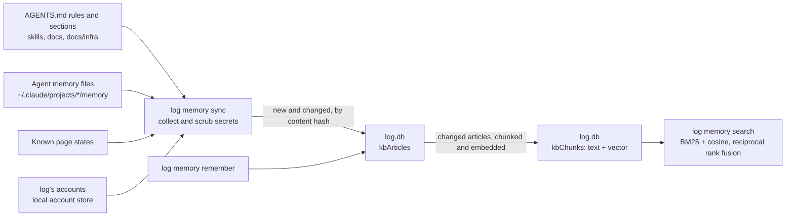

# Memory

`log memory` keeps everything log knows (its rules, skills, docs, agent memories, known page states and accounts) in one searchable place agents share. The articles and their search index live in the workspace `log.db`, beside the rest of log's private records, and are searched on this machine in milliseconds. Use it when an agent needs context fast, or when you want to save something it should remember. It needs no server and no setting: it always works.

In short:

1. `log memory sync` collects every source, removes secrets, and writes new or changed articles to `kbArticles` (compared by content hash).
2. Changed articles are split into chunks, embedded on this machine, and written to `kbChunks` with their vectors.
3. `log memory search` ranks the chunks by keyword (BM25) and by meaning (cosine similarity of the embeddings) and merges the two.

## Commands

| Command | What it does |
| --- | --- |
| `log memory search "<query>" [--kind <kind>] [--limit <n>]` | Finds the best articles for the query. Keyword search (BM25) and meaning search (cosine over all-MiniLM-L6-v2) are merged with reciprocal rank fusion, and each article appears once. |
| `log memory show <key>` | Shows one article in full, from `log.db`. |
| `log memory remember "<text>" [--title] [--tags]` | Saves a note to `log.db` and indexes it at once. |
| `log memory sync [--noAccounts]` | Collects every source, writes what changed to `log.db`, and re-indexes what changed. |

Kinds: `rule`, `section`, `skill`, `doc`, `infra`, `memory`, `pageState`, `account`, `note`. The skill `skills/memory/SKILL.md` says where each kind comes from. Over MCP they are `memorySearch`, `memoryShow`, `memoryRemember` and `memorySync`; what each must do is in the spec, [Memory](specs/memory.md). `log kb …` still works as an alias for one release.

## Where it lives

| Part | Where |
| --- | --- |
| Articles | `kbArticles` in the workspace `log.db`: key, kind, title, body, source, tags, author, content hash, synced at |
| Search index | `kbChunks` in the same `log.db`: each chunk's text, its article key, kind, title and source, the content hash and model it was embedded from, and its vector |
| Embeddings | The machine running log: `Xenova/all-MiniLM-L6-v2` (384 dimensions), the same model `log search` uses |

Both tables come from `log.db`'s versioned schema (migration 33, `knowledgeBase`); they keep their `kb` names from before the rename to memory. Chunks embedded by another model are re-embedded on the next sync, and a search reads only the chunks of the current model.

## Secrets

Nothing secret is written. Every article goes through `scrubSecrets` first. These become `<redacted>`:

- named keys (`password=`, `token:`, `apiKey=`, `pin:`…);
- URLs with a login in them;
- JWTs and private keys;
- any long random string that mixes letters and digits.

`docs/vendors` is never collected. Accounts carry only their status and setup: no cookies, proxy URL, device, email, password or 2FA secret.

## Limits

- The index is rebuilt from the articles: if `kbChunks` is emptied, `log memory sync` re-indexes every article.
- Search reads every chunk of the current model into memory per query, which suits a memory of a few thousand chunks.

## Related

- Up: [How log works](howItWorks.md) · [log's README](../README.md)
