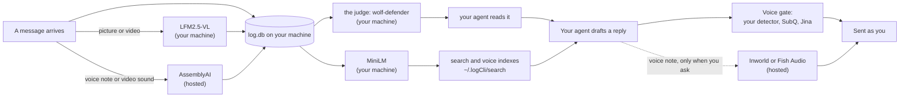

# Local models: what runs on your machine, pinned and checked

log runs five downloaded models on your own machine, each pinned to one exact revision, plus two small models it trains on your own data. This page is for anyone installing or running log who wants to know what each local model does, how log checks that the right files are present, and how they are downloaded and updated. It covers only the models: what leaves your machine is on the [trust page](trust.md#what-leaves-your-machine), and how a release moves code and models together is in [updates and releases](updates.md). `log models` alone does not download anything: fetching needs `--fetch` and the owner's `--approvedBy` ([`src/cli/models/index.ts`](../src/cli/models/index.ts)).

## Local and hosted models at a glance

Local models need no key and no internet once their files are on disk. Hosted services are used only when you add their key; leave a key out and the feature that needs it is off.

| Model | Where it runs | What it does in log | Pinned | Key |
|---|---|---|---|---|
| the five models in the pinned local models table below | your machine | the judge, meaning search, emotions, picture descriptions, mouse paths | yes, checked by `log models` | none |
| your AI-writing detector, trained by `log voice train` | your machine | the voice gate's AI reading, trained on your own messages ([`src/voice/conventions`](../src/voice/conventions)) | no, built from your data | none |
| your pipeline labeller, trained by `log inbox label train` | your machine | who each person is and where they are in your sales cycle ([pipeline labels](pipelineLabels.md)) | no, built from your data | none |
| SubQ `subq-snap-1.1` | hosted | the voice gate (does a draft sound like you), reading an unknown page state, briefs, meme taste, and the labeller's teacher | no | `SUBQ_API_KEY` |
| Jina `jina-embeddings-v5-omni-small` and `jina-reranker-v3.5` | hosted | ranking a chat's history for the voice gate, with a local fallback | no | `JINA_API_KEY` |
| AssemblyAI | hosted | what was said in a voice note or a video | no | `ASSEMBLYAI_API_KEY` |
| Inworld `inworld-tts-2` or Fish Audio `s2.1-pro` | hosted | a voice note in your cloned voice, only when you ask | no | `INWORLD_API_KEY` or `FISH_API_KEY` |

The hosted model names are in the code: `VOICE_MODEL` ([`src/twitter/copy/voice/types.ts`](../src/twitter/copy/voice/types.ts)), `JINA_EMBED_MODEL` and `JINA_RERANK_MODEL` ([`src/voice/aiTells/types.ts`](../src/voice/aiTells/types.ts)), and the voice providers in [`src/extensions/inworld`](../src/extensions/inworld) and [`src/extensions/fishAudio`](../src/extensions/fishAudio). What each hosted service receives is listed once, on the [trust page](trust.md#what-leaves-your-machine).

## Where each model sits in the flow of a message

## The pinned local models

Every local model is listed in `LOCAL_MODELS` ([`src/models/manifest/types.ts`](../src/models/manifest/types.ts)) with its id, exact revision, and each file's size and hash. The sizes below are the ones `log models` prints.

| Key | Model and revision | Size | What it does | Loaded by | Tests |
|---|---|---|---|---|---|
| `judge` | [`patronus-studio/wolf-defender-prompt-injection-small`](https://huggingface.co/patronus-studio/wolf-defender-prompt-injection-small) @ `2484cc9` | 142 MB | scores prompt injection in what other people wrote, before an agent reads it | the judge server, [`python/judge/server.py`](../python/judge/server.py) | [`judgeModel.test.ts`](../src/inbox/judgeModel/judgeModel.test.ts) |
| `embed` | [`Xenova/all-MiniLM-L6-v2`](https://huggingface.co/Xenova/all-MiniLM-L6-v2) @ `751bff3` | 24 MB | meaning vectors for search, the voice index, the knowledge base and the prompt router | the embed worker: warm context service, search, router ([`embedWorker.ts`](../src/search/conversations/helpers/embedWorker.ts)) | [`client.test.ts`](../src/search/conversations/client.test.ts) |
| `emotion` | [`SamLowe/roberta-base-go_emotions-onnx`](https://huggingface.co/SamLowe/roberta-base-go_emotions-onnx) @ `90ee0c1` | 128 MB | the top emotions of each new message someone sends you, a feature for [who and where](pipelineLabels.md) | the pipeline labeller in the inbox push ([`emotionWorker.ts`](../src/inbox/pipeline/helpers/emotionWorker.ts)) | [`pipeline.test.ts`](../src/inbox/pipeline/pipeline.test.ts) |
| `vision` | [`onnx-community/LFM2.5-VL-450M-ONNX`](https://huggingface.co/onnx-community/LFM2.5-VL-450M-ONNX) @ `24e6300` | 368 MB | describes pictures, memes and video frames as text | the media describer, `log media describer` ([`model.ts`](../src/media/describer/helpers/model.ts)) | [`describer.test.ts`](../src/media/describer/describer.test.ts) |
| `mouse` | `myuri` @ `5.0.0` | a pip package | plans human mouse paths, typing and scrolling | every browser log drives for you, in `LOG_PYTHON` ([`python/human`](../python/human)) | [`test_humanMouse.py`](../python/human/test_humanMouse.py) |

[`manifest.test.ts`](../src/models/manifest/manifest.test.ts) checks that each loader asks for the same model and revision the manifest pins, and that `MODEL_REVISION` in `python/judge/server.py` equals the judge's pin.

## Checking the pins with log models

`log models` (MCP tool `models`) prints one line per model and a summary, and changes nothing ([`models.test.ts`](../src/cli/models/models.test.ts)). On this project's machine on 2026-11-21 it ended with `all 5 on the pinned revision`.

Each line says one of these states ([`src/models/store/client.ts`](../src/models/store/client.ts)):

| State | Meaning |
|---|---|
| `present, matches` | every pinned file is there at its pinned size, or the pip package is at the pinned version |
| `not fetched yet` | none of the model's files are there |
| `present, does not match` | some files are missing or a file has another size |
| `not installed` | the pip package is not in `LOG_PYTHON` |
| `another version installed` | the pip package is at another version |

`matches` in `log models` compares file sizes only. Each file's sha256 or git blob hash is checked when it is fetched: by `--fetch`, by the after-install routine, or by a worker before its first load. When a matching copy sits in transformers.js's old cache inside `node_modules`, the line says so, and `--fetch` moves it instead of downloading it again ([`store.test.ts`](../src/models/store/store.test.ts)). `log version --json` lists the pins under `models`.

## Where model files live

Model files live under your log home (`~/.logCli` unless `LOG_HOME` moves it), outside the installed package, so an update keeps them ([`src/models/store/client.ts`](../src/models/store/client.ts), [`store.test.ts`](../src/models/store/store.test.ts)):

- the judge in `~/.logCli/models/wolfDefenderSmall` (`LOG_JUDGE_MODEL` moves it);
- the transformers.js models in `~/.logCli/models/hf/<id>/<revision>/`, so a new pin lands beside the old one;
- the pip package in the Python that `LOG_PYTHON` names.

## How a model is downloaded, verified and updated

`log models --fetch --approvedBy <who>` (MCP `modelsLive`) runs `fetchModels`, model by model and file by file ([`src/models/store/client.ts`](../src/models/store/client.ts)):

1. A file already there with the pinned size and hash is kept.
2. A matching copy in the old transformers.js cache is moved in.
3. Otherwise the file is downloaded from `<HF_ENDPOINT>/<id>/resolve/<revision>/<file>` to a `.part` file, renamed when complete, then hashed. `HF_ENDPOINT` points it at a mirror.
4. A pip model is installed as `<id>==<revision>` with `uv pip install`, falling back to `pip`.

The same `fetchModels` runs in the after-install routine that the install scripts and `log update` share ([`src/release/postInstall/client.ts`](../src/release/postInstall/client.ts), [`postInstall.test.ts`](../src/release/postInstall/postInstall.test.ts)); `LOG_MODELS=off` skips it ([`scripts/update/postInstall.ts`](../scripts/update/postInstall.ts)). A release that changes a pin fetches the new files on `log update`, and the update's answer ends with the models summary ([`apply.test.ts`](../src/release/apply/apply.test.ts)). The release steps are in [updates and releases](updates.md).

Before its first load, the embed, emotion and vision workers call `pinnedModelReady`, which runs the same check and fetch, then pass the pinned revision to transformers.js.

To move a model to a new revision, change its `revision`, files, sizes and hashes in `src/models/manifest` (read them from `https://huggingface.co/api/models/<id>/revision/<sha>?blobs=true`), keep `MODEL_REVISION` in `python/judge/server.py` equal for the judge, and run `manifest.test.ts`. The next release's `Models:` line in the README's releases table says what changed.

## When a model is missing or does not match

- **`log models`** names the files that are missing or another size, exits 0, and suggests `log models --fetch --approvedBy <who>`.
- **`--fetch`** removes a download whose hash does not match the pin and refuses with `modelFetchFailed` ([error catalog](errorCatalog.md), [`store.test.ts`](../src/models/store/store.test.ts)). An interrupted download leaves no file under the pinned name; its `.part` file is removed ([`effects.ts`](../src/models/store/helpers/effects.ts)).
- **The after-install routine and `log update`** report a model that could not be fetched as `needs a look` and finish the other steps, because models are not a blocking step (`BLOCKING_STEPS` in [`src/release/postInstall/types.ts`](../src/release/postInstall/types.ts)). `log models --fetch` finishes it later.
- **A worker whose model could not be fetched** still hands transformers.js the pinned revision, and transformers.js then loads or downloads that revision itself (`readyPinned` in [`src/models/store/client.ts`](../src/models/store/client.ts)).
- **The judge server** downloads its pinned revision with `huggingface_hub` when its model or tokenizer file is missing, or when its recorded revision differs ([`python/judge/server.py`](../python/judge/server.py)). With the judge model off, the judge's rules decide alone ([`judgeModel.test.ts`](../src/inbox/judgeModel/judgeModel.test.ts)).

## What your machine needs

Measured on this project's own machine on 2026-11-09 (Windows 11, 16 threads, CPU only, no GPU):

| Model | Load | Each use | Memory |
|---|---|---|---|
| MiniLM | 0.17 s | 2.8 ms p50, 9.8 ms p95 to embed one message (20 runs) | small, inside the process using it |
| go_emotions RoBERTa | 1.3 s | 24 ms p50, 35 ms p95 per message on a quiet machine, run after the who and where labels so it never holds the push | inside the push process |
| LFM2.5-VL | 5.7 s | 6.3 to 7.4 s per picture (3 runs) | peaked at 1.25 GB; about 100 MB idle between pictures |

The judge model was not measured. So, at least:

- **A 64-bit machine.** Every local model runs on the CPU, so no GPU is needed.
- **About 2 GB of free memory** for the picture model while it works. The describer stops itself past 4 GB, and at most 20 pictures queue (`MEMORY_CEILING_MB` and `QUEUE_LIMIT` in [`src/media/describer/types.ts`](../src/media/describer/types.ts)). Until a picture is described it shows as `[picture … not described yet]`.
- **About 661 MB of disk** for the four downloaded models, the sum of their `bytes` in [`src/models/manifest/types.ts`](../src/models/manifest/types.ts).
- **ffmpeg and ffprobe** on your PATH for videos and voice notes (`LOG_FFMPEG` and `LOG_FFPROBE` point elsewhere).
- **Bun and Python 3.12**, set up by the [installer](install.md). `log voice train` also needs scikit-learn in that Python (`uv pip install --python <LOG_PYTHON> "scikit-learn>=1.5,<2"`); without it the trainer runs through `uv run --with scikit-learn`.

## Turning a local model off

| Model | How to turn it off | Code |
|---|---|---|
| every model download at install or update | `LOG_MODELS=off` | [`scripts/update/postInstall.ts`](../scripts/update/postInstall.ts) |
| `judge` | `LOG_JUDGE_MODEL_OFF=1`; the judge's rules still run | [`src/inbox/judgeModel/client.ts`](../src/inbox/judgeModel/client.ts) |
| `emotion`, and the labeller's use of `embed` | `LOG_PIPELINE=off` stops the push labeller | [`scripts/hooks/push.ts`](../scripts/hooks/push.ts) |
| `embed` in the warm context service | `LOG_CONTEXT_SERVICE=off`; `log search` still loads it when you run it | [`src/contextLayer/service/client.ts`](../src/contextLayer/service/client.ts) |
| `vision` | no switch of its own; `LOG_INBOX_POLL=off` stops the session hook starting the describer, together with the inbox watchers | [`src/inbox/watch/client.ts`](../src/inbox/watch/client.ts) |
| `mouse` | no switch; it loads only when log drives a browser | [`python/human`](../python/human) |

## How the search and voice indexes are built

Every index is built from what is already in `log.db`, and each one is rebuilt in full by its command. On a new machine, run them in this order:

1. **`log search index`** reads every conversation once and builds a keyword (BM25) and a meaning (MiniLM, HNSW) index in `~/.logCli/search`. After that, each new read adds only what changed, and `log search "<query>"` merges both.
2. **`log voice index`** builds your voice from what step 1 saved: each of your replies with what was said before it, embedded with MiniLM, plus a profile per chat, person and platform.
3. **`log voice train`** trains your AI-writing detector: your own messages against drafts agents wrote for your chats and, with `--fresh <n>`, drafts from several frontier models (it prints the cost first and stops at `--spend`, $3 by default). The classifier is char n-grams plus MiniLM, fitted with scikit-learn in `LOG_PYTHON`, with one bar per message length so 95% of your own held-out messages pass. The voice gate starts it in the background when it is missing or older than step 2.
4. **`log inbox label teach --apply`**, then **`log inbox label train`**, label your chats and train the local pipeline labeller ([pipeline labels](pipelineLabels.md)).
5. **`log kb sync`** (optional) puts rules, skills, docs and agent memory into the [knowledge base](knowledgeBase.md).

Pictures and videos are not indexed by a command: the describer describes each one as it arrives, and `log media status` shows the queue.

## Why these models

- **Small enough to run on any machine.** Every pinned model runs on a CPU, so reading, searching, judging and describing need neither the internet nor a key once the files are here.
- **Text for every model.** Every picture, voice note and video becomes text when it arrives ([how log works](howItWorks.md)), so an agent whose model can't see images still knows what was sent.
- **Hosted only where it pays.** The voice gate and transcripts are worth a hosted model, and each one's balance is in `log balance`.

## Related pages

- Up: [How log works](howItWorks.md) · [log's README](../README.md)
- [Trust: what leaves your machine](trust.md#what-leaves-your-machine) · [Updates and releases](updates.md) · [Install](install.md) · [Pipeline labels](pipelineLabels.md) · [The local models use case](useCases/log/localModels.md)
