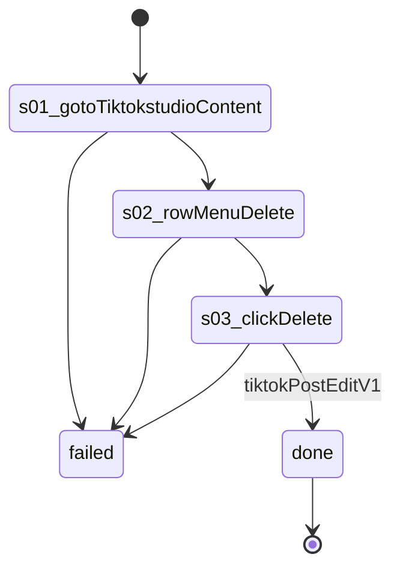

# Flow: `tiktokDelete`

Delete one of the account's own TikTok posts from TikTok Studio's content list: the post's row menu (found by its caption), Delete, then Delete in "Delete post?", wait for tiktokPostEditV1 (status_code 0 for the aweme_id sent). TikTok keeps it in Recently deleted for 30 days. Deletes on TikTok (--live).

Built by `log flow fromInspect` from the recording `~/.logCli/runs/inspect/20261117T053323` (account tiktokDelete). Run it on any account with `log flow run tiktokDelete --account <a> --live`, or over MCP as the tool `tiktokFlowDelete` (rule 31).

## Params

- `caption` (text): the post's caption as its row link shows it in TikTok Studio's content list

## Steps

| # | Step | Does | Confirmed by | TikTok must answer (rule 73) | Recorded |
| --- | --- | --- | --- | --- | --- |
| 1 | `s01_gotoTiktokstudioContent` | open `https://www.tiktok.com/tiktokstudio/content` | — | — | 01_gotoHttpsWwwTiktok, 12933 ms |
| 2 | `s02_rowMenuDelete` | rowMenu "{caption}" > "Delete" | — | — | 06_clickE943, 10210 ms, rea `ev_49e37914780d5be2802f93ca4111bab10420f78f6fed6151e669c21cb7bfeade` |
| 3 | `s03_clickDelete` | click button "Delete" | `tiktokPostEditV1` | `tiktokPostEditV1` 2xx: `status_code` = `0`; `edit_diff.aweme_id` = what we sent as `body.aweme_id` | 07_clickroleButtonDelete, 7579 ms, rea `ev_a8d352dabf9c11e40d9e8b2ccb4806c42bedc28bc13292d2dabfce6bda72322a` |

## Machine

