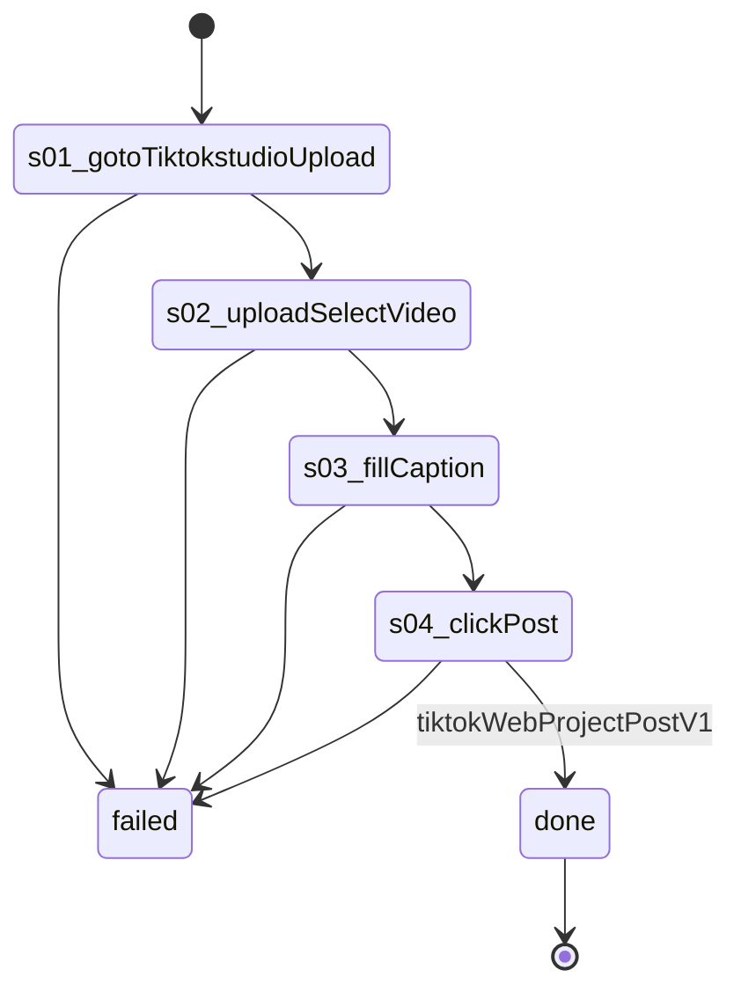

# Flow: `tiktokPost`

Post one video from TikTok Studio: Select video hands the file to the chooser, the caption replaces the file name TikTok prefills, Post, wait for tiktokWebProjectPostV1 (status_code 0 and an item_id). Writes on TikTok (--live).

Built by `log flow fromInspect` from the recording `~/.logCli/runs/inspect/20261117T052642` (account tiktokPost). Run it on any account with `log flow run tiktokPost --account <a> --live`, or over MCP as the tool `tiktokFlowPost` (rule 31).

## Params

- `video` (file): the video file, uploaded through button "Select video"
- `fileName` (text): the video's file name without its extension: TikTok prefills the caption box with it, so the box is found by it
- `caption` (text): the caption, typed into the caption box in place of the file name

## Steps

| # | Step | Does | Confirmed by | TikTok must answer (rule 73) | Recorded |
| --- | --- | --- | --- | --- | --- |
| 1 | `s01_gotoTiktokstudioUpload` | open `https://www.tiktok.com/tiktokstudio/upload` | — | — | 02_snapshot, 4606 ms, rea `ev_99d461e9d87a089a4d2626b4071798d832cdf73882a672fc3aff932fc7123abd` |
| 2 | `s02_uploadSelectVideo` | upload button "Select video" with `{video}` | — | — | 03_uploadroleButtonSelectVideo, 13383 ms, rea `ev_f3452dcafee035ea27a1e5d4fc8b376444da235cbb822d46e239517deab27646` |
| 3 | `s03_fillCaption` | fill combobox "{fileName}" with `{caption}` | — | — | 06_fillroleComboboxTestclip, 5613 ms, rea `ev_4b714b5091058afb1cb07ae714490310b5acf80f654a6d152080b25cbfad8147` |
| 4 | `s04_clickPost` | click button "Post" | `tiktokWebProjectPostV1` | `tiktokWebProjectPostV1` 2xx: `status_code` = `0`; `single_post_resp_list.0.status_code` = `0`; `single_post_resp_list.0.item_id` is present | 07_clickroleButtonPost, 10139 ms, rea `ev_693e9d080dbb9d215fe96b445290b39d2f41a82e58ad23b4809c7fb6db981978` |

## Machine

