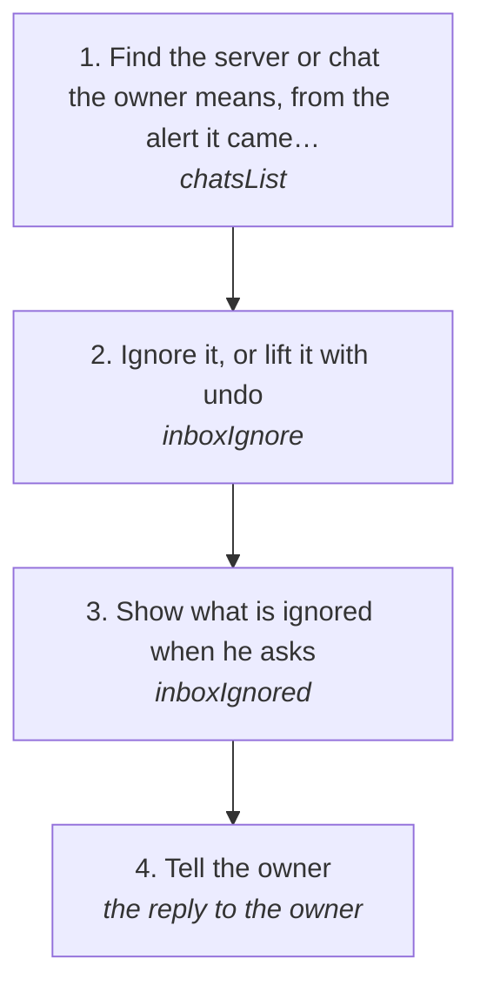

# Ignoring a server or a chat

The live push brings every message that mentions, replies to or talks with the owner into his session. Some servers are only noise to him. When he says to ignore one, the push stops alerting on it: its messages are still heard and stored, readable any time, and DMs from the same people still come through. Undo lifts it.

How the owner asks for it: "ignore that server", "mute that channel", "stop the alerts from there", "unignore it"

## Run it from a fresh context

Say: **"go on docs/useCases/inbox/ignoreServer.md for <server or chat>"**. The agent reads this page and runs the steps.

## The steps

<!-- stepsDiagram: written by `bun run docs:build` from the steps table below, not edited by hand -->

<!-- /stepsDiagram -->

| # | Step | Tool | Done when |
| --- | --- | --- | --- |
| 1 | Find the server or chat the owner means, from the alert it came in on (its channel) | `chatsList` { account } or the channel in the alert | one server id, or one chat id when he means just that channel |
| 2 | Ignore it, or lift it with undo | `inboxIgnore` { platform, server or chat, by: "<owner>", undo? } | the tool says it is no longer pushed |
| 3 | Show what is ignored when he asks | `inboxIgnored` {} | every ignored server and chat with who asked |
| 4 | Tell the owner | the reply to the owner | he knows that server is quiet, nothing is lost, and how to undo it |

## Related

- Up: [All use cases](../README.md)
- [Connect your agent](../../mcp.md) · [Trust](../../trust.md)
