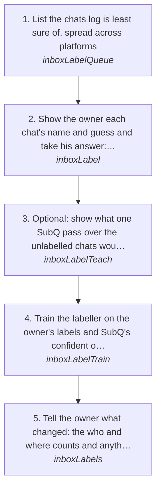

# Teaching log who your people are

log reads who each person is and where they are on every new message, with a small model on this machine. It is only as good as the labels it learns from, so it asks the owner about the chats it is least sure of, about ten minutes of his time, then trains on his answers. SubQ can label the rest once, as a paid pass he approves after seeing the cost.

How the owner asks for it: "what should i label", "teach the labeller", "train the labeller", "which chats are you unsure about"

## Run it from a fresh context

Say: **"go on docs/useCases/inbox/labelQueue.md"**. The agent reads this page and runs the steps.

## The steps

<!-- stepsDiagram: written by `bun run docs:build` from the steps table below, not edited by hand -->

<!-- /stepsDiagram -->

| # | Step | Tool | Done when |
| --- | --- | --- | --- |
| 1 | List the chats log is least sure of, spread across platforms | `inboxLabelQueue` { limit? } | up to 35 chats, each with log's guess |
| 2 | Show the owner each chat's name and guess and take his answer: who, and where only for a lead or client | `inboxLabel` { platform, account, chat, who, where?, by: "<owner>" } | each answer is stored |
| 3 | Optional: show what one SubQ pass over the unlabelled chats would cost; run it with apply only after the owner says yes to that cost | `inboxLabelTeach` { apply? } | the cost is shown, or SubQ's labels are stored |
| 4 | Train the labeller on the owner's labels and SubQ's confident ones | `inboxLabelTrain` {} | a head is stored with its counts |
| 5 | Tell the owner what changed: the who and where counts and anything that moved | `inboxLabels` {} | he sees the new counts |

## Related

- Up: [All use cases](../README.md)
- [Connect your agent](../../mcp.md) · [Trust](../../trust.md)
