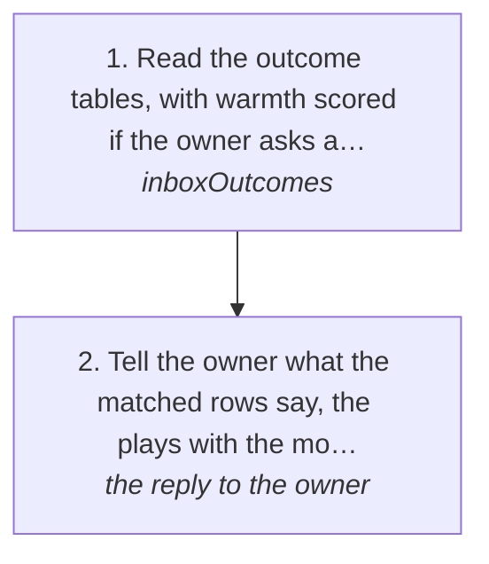

# Do people answer what log sends?

log reads every send in log.db and splits them into the ones log sent (a send record, a sent queue item, or a log send call at that moment) and the ones the owner typed himself. It then compares how often and how fast people answered each, and whether they moved on to a later stage, first raw and then matched to the same person at the same stage, so a warmer audience for either side doesn't decide it. Nothing is sent and nothing is written.

How the owner asks for it: "do people reply to what log sends", "are log's messages working", "which plays get answers"

## Run it from a fresh context

Say: **"go on docs/useCases/inbox/outcomes.md"**. The agent reads this page and runs the steps.

## The steps

<!-- stepsDiagram: written by `bun run docs:build` from the steps table below, not edited by hand -->

<!-- /stepsDiagram -->

| # | Step | Tool | Done when |
| --- | --- | --- | --- |
| 1 | Read the outcome tables, with warmth scored if the owner asks about tone | `inboxOutcomes` { platform?, account?, feelings? } | raw and matched rates are shown with their sample sizes |
| 2 | Tell the owner what the matched rows say, the plays with the most sends, and where the samples are too small to say anything | the reply to the owner | he has the answer in a few lines |

## What to know

- Matched rows are the ones to trust: raw rates mix who log writes to (cold openers) with who the owner talks to by hand (friends mid-chat).
- A window counts a send only once it has passed, so the newest plays show n=0 at 7 days.
- With `json` the answer carries `view`, a report spec of blocks for a card.
