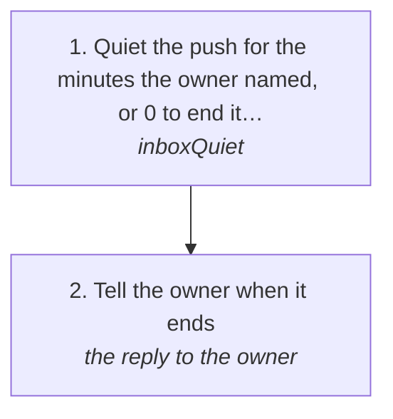

# Quieting the live push

The live push brings every new message into the owner's session the moment it lands. When the owner wants a break from it, the push goes quiet for as many minutes as he says: the watchers keep hearing and storing everything, nothing is pushed into any session until then, and what came in arrives as one batch when it ends.

How the owner asks for it: "go silent for 30 minutes", "turn the notifications back on"

## Run it from a fresh context

Say: **"go on docs/useCases/inbox/quietPush.md for <minutes>"**. The agent reads this page and runs the steps.

## The steps

<!-- stepsDiagram: written by `bun run docs:build` from the steps table below, not edited by hand -->

<!-- /stepsDiagram -->

| # | Step | Tool | Done when |
| --- | --- | --- | --- |
| 1 | Quiet the push for the minutes the owner named, or 0 to end it now | `inboxQuiet` { minutes, by: "<owner>" } | the time it ends |
| 2 | Tell the owner when it ends | the reply to the owner | the owner knows the push is quiet until then, and that nothing is lost |

## Related

- Up: [All use cases](../README.md)
- [Connect your agent](../../mcp.md) · [Trust](../../trust.md)
