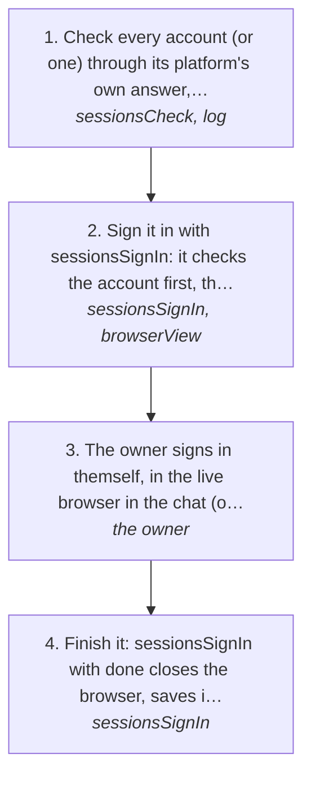

# Signing an account in: checking it, then the live browser

An account's session has run out, or it was never signed in. The agent checks it through the platform's own answer, and when it needs a person, it opens the account's own browser for the owner to sign in. It is streamed into the chat as a live view, on the owner's own machine and from a remote runtime alike, the same one the console's Connections page opens; on the owner's machine its window is on their screen too. The agent never types a password; the owner does.

How the owner asks for it: "sign in to my account", "is my x account logged in", "check my accounts", "log me back into instagram", "my session expired", "check the status of my accounts", "open the browser so I can sign in", "sign into my discord account", "sign me in", "log me in here", "open the browser in the chat", "show me the browser", "log me in in hermes"

## Run it from a fresh context

Say: **"go on docs/useCases/inbox/signIn.md for <account>"**. The agent reads this page and runs the steps.

## The steps

<!-- stepsDiagram: written by `bun run docs:build` from the steps table below, not edited by hand -->

<!-- /stepsDiagram -->

| # | Step | Tool | Done when |
| --- | --- | --- | --- |
| 1 | Check every account (or one) through its platform's own answer, never a screen. A 401 or no saved session is "needs signing in", with its next step. An account held stopped is never checked again (rule 94) | `sessionsCheck` { platform?, account? } (the CLI's `log sessions check`, the console's Check) | each account signed in, needs signing in, stopped or unknown |
| 2 | Sign it in with `sessionsSignIn`: it checks the account first, then opens the account's own browser on the platform's login screen (X, with no browser yet, takes the masked cookie prompt in a terminal). Then `browserView` streams that open browser live into the chat: an MCP Apps host draws the view itself, and in Hermes Desktop the agent writes the `::logbrowser{account="..."}` line its answer names (the shortcut for `::logapp{tool="browserView"}`), on its own line | `sessionsSignIn` { account, platform? }, then `browserView` { account } | the answer is waitingForOwner, and the live browser is in the chat |
| 3 | The owner signs in themself, in the live browser in the chat (or its window on their screen). Their clicks and typing reach the page only while it still asks for sign-in | the owner | the page has moved past sign-in |
| 4 | Finish it: `sessionsSignIn` with done closes the browser, saves its session only when the platform's own sign-in cookies are in it, and checks again. Only call it signed in when the platform says so (rule 25) | `sessionsSignIn` { account, done: true } | signed in |

## What to know

- **One sign-in, everywhere.** `sessionsSignIn`, `log sessions signIn` and the console's Sign in and Browser check run the same machine (`src/platformKit/signIn`), and the console's Connections page and `browserView` use the same live browser, through `src/browser/viewer`. Every check is recorded against the account, so all of them show the same state.
- **A signed-out browser saves nothing.** Closing the browser keeps the stored session unless the platform's own sign-in cookies are there; the answer says what was saved.
- **Where it shows.** The live browser streams inline in MCP Apps hosts (Claude, ChatGPT, Cursor), where the view draws itself, and in Hermes Desktop, where the agent writes the `::logbrowser{account="..."}` line from `browserView`'s answer on its own line. It streams on the owner's own machine too (a loopback relay, or frame pulls), and there the headed window is also on their screen. A host that draws neither (Claude Code, Codex, Telegram) gets the text answer, which says where to sign in.
- **A checkpoint is a stop.** A captcha, a code the platform sends, or a security check is the owner's to answer. The agent waits and checks again, and never retries around it (rule 94).
- **Passwords stay with the owner.** The agent opens the browser and checks the result; it never types a password or a code.
