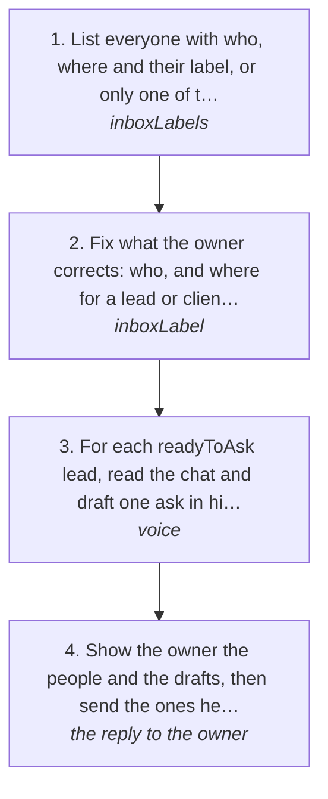

# Working the warm people in your dms

The people already in the owner's dms are the easiest yes. Every one of them carries who they are (lead, client, partner, friend, community, bot) and, for a lead or client, where they are (new, warming, needFound, offered, callBooked, won, lost, goneQuiet), read by a small local model on every new message, plus the old label: warming, readyToAsk, askedWaiting, cold, skip, friend or client. A bot, friend or partner never gets a sales stage, and the owner's own label always wins. The agent pulls the readyToAsk leads, reads each chat, and drafts the ask in his words.

How the owner asks for it: "who's warm", "who can i ask now", "label my people", "who have we been warming up", "mark him as a friend"

## Run it from a fresh context

Say: **"go on docs/useCases/inbox/warmPeople.md"**. The agent reads this page and runs the steps.

## The steps

<!-- stepsDiagram: written by `bun run docs:build` from the steps table below, not edited by hand -->

<!-- /stepsDiagram -->

| # | Step | Tool | Done when |
| --- | --- | --- | --- |
| 1 | List everyone with who, where and their label, or only one of them | `inboxLabels` { label?, who?, where? } | each person with who, where, a label and why |
| 2 | Fix what the owner corrects: who, and where for a lead or client, or undo to go back | `inboxLabel` { platform, account, chat, who, where?, by: "<owner>", undo? } | the tool says the label is set |
| 3 | For each readyToAsk lead, read the chat and draft one ask in his words, never to a friend, partner, bot or client | `voice` { to, with } | a gated draft per person |
| 4 | Show the owner the people and the drafts, then send the ones he says yes to | the reply to the owner | he knows who is warm and what goes out |

## Related

- Up: [All use cases](../README.md)
- [Connect your agent](../../mcp.md) · [Trust](../../trust.md)
