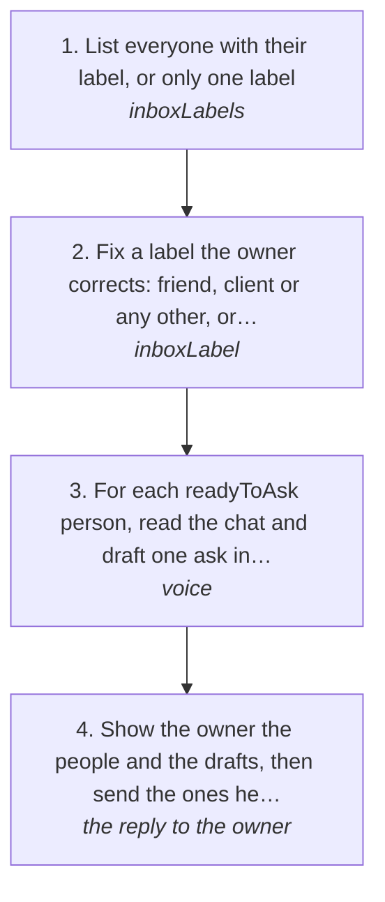

# Working the warm people in your dms

The people already in the owner's dms are the easiest yes. Every one of them carries a label worked out from log.db: warming (talking, no ask yet), readyToAsk (enough back and forths and they still write), askedWaiting (he asked and they haven't answered), cold (quiet for three weeks), skip (never wrote back). The owner sets friend (never pitch) and client (money, he answers) by hand, and his label always wins. The agent pulls the readyToAsk people, reads each chat, and drafts the ask in his words.

How the owner asks for it: "who's warm", "who can i ask now", "label my people", "who have we been warming up", "mark him as a friend"

## Run it from a fresh context

Say: **"go on docs/useCases/inbox/warmPeople.md"**. The agent reads this page and runs the steps.

## The steps

<!-- stepsDiagram: written by `bun run docs:build` from the steps table below, not edited by hand -->

<!-- /stepsDiagram -->

| # | Step | Tool | Done when |
| --- | --- | --- | --- |
| 1 | List everyone with their label, or only one label | `inboxLabels` { label? } | each person with a label and why |
| 2 | Fix a label the owner corrects: friend, client or any other, or undo to go back | `inboxLabel` { platform, account, chat, as, by: "<owner>", undo? } | the tool says the label is set |
| 3 | For each readyToAsk person, read the chat and draft one ask in his words, never to friend or client | `voice` { to, with } | a gated draft per person |
| 4 | Show the owner the people and the drafts, then send the ones he says yes to | the reply to the owner | he knows who is warm and what goes out |
