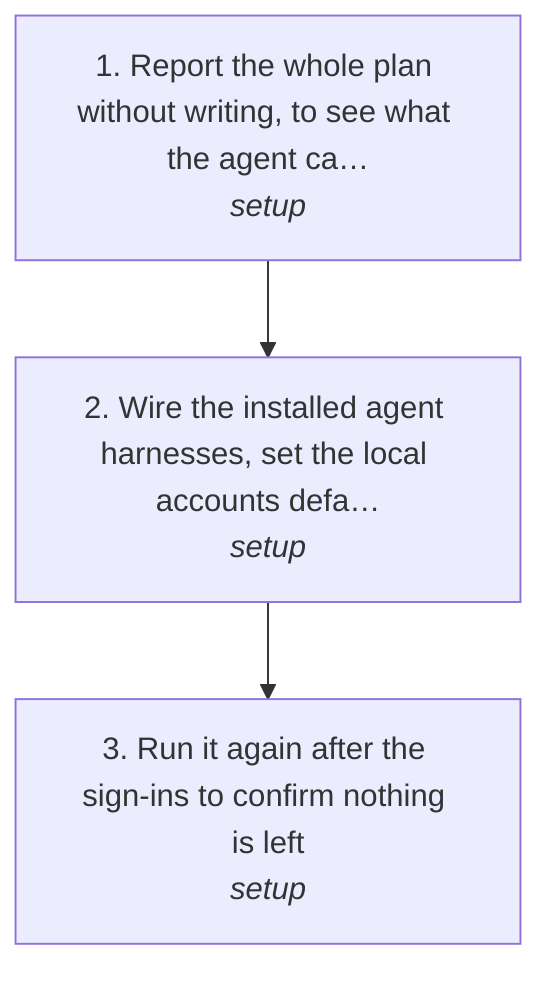

# Set up log in one pass

An agent can set up everything that does not need a browser sign-in in a single command, then name the sign-ins only the owner can finish. The command never asks a question or invents a key, and a second run reports what is already done.

How the owner asks for it: "set up log in one pass", "make log work without me walking through the wizard", "what's left to sign in to"

## Run it from a fresh context

Say: **"go on docs/useCases/log/agentSetup.md"**. The agent reads this page and runs the steps.

## The steps

<!-- stepsDiagram: written by `bun run docs:build` from the steps table below, not edited by hand -->

<!-- /stepsDiagram -->

| # | Step | Tool | Done when |
| --- | --- | --- | --- |
| 1 | Report the whole plan without writing, to see what the agent can do and what needs the owner | `setup` { json: true, dryRun: true } | the plan lists the agent steps and the sign-ins, with exit code 3 when a person is needed |
| 2 | Wire the installed agent harnesses, set the local accounts default and list the remaining sign-ins | `setup` { json: true } | every agent step is done; `next` holds the exact sign-in commands, in order |
| 3 | Run it again after the sign-ins to confirm nothing is left | `setup` { json: true } | exit code 0, an empty `pending` list |

## What to know

- **No prompts.** `log setup` never needs a TTY. The interactive `log launch --setup` wizard stays for the owner who wants to click through platforms.
- **Nothing secret is invented.** Keys, cookies and 2FA still go in a terminal, with the command and place named in `pending`.
- **Resumable.** Re-running reports already-wired harnesses and an already-set `LOG_ACCOUNTS` as done; it does not repeat them.
- **A config file works too.** `--config <file>` takes a JSON object with `platforms`, `extensions` and `harnesses` arrays; it is combined with the flags.

## Related

- Up: [All use cases](../README.md)
- [Install](../../install.md) · [Connect your agent](../../mcp.md)
