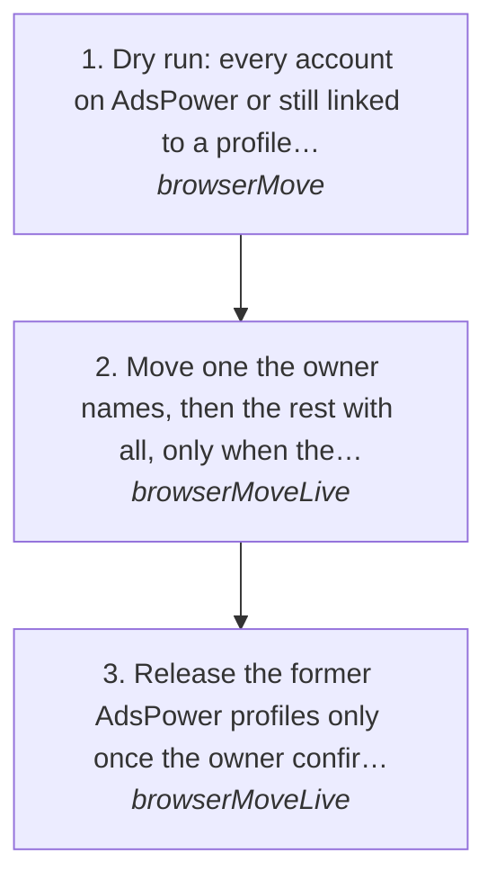

# Moving accounts to another browser

AdsPower is deprecated and Camoufox is log's browser. The agent moves accounts off AdsPower (or between any two browsers) with their signed-in session, and only calls one moved when the platform says it is signed in.

How the owner asks for it: "move my accounts off adspower", "move everything to camoufox", "switch this account to brave", "get rid of adspower"

## Run it from a fresh context

Say: **"go on docs/useCases/log/browserMove.md"**. The agent reads this page and runs the steps.

## The steps

<!-- stepsDiagram: written by `bun run docs:build` from the steps table below, not edited by hand -->

<!-- /stepsDiagram -->

| # | Step | Tool | Done when |
| --- | --- | --- | --- |
| 1 | Dry run: every account on AdsPower or still linked to a profile, what will carry, whether AdsPower answers. Nothing changes | `browserMove` { all: true, to } | the plan is shown to the owner |
| 2 | Move one the owner names, then the rest with all, only when the owner says so | `browserMoveLive` { account or all, to, apply: true, approvedBy, confirmLive: true } | each account moved (the platform said signed in), skipped or rolled back with its reason |
| 3 | Release the former AdsPower profiles only once the owner confirms | `browserMoveLive` { release: true, apply: true, approvedBy, confirmLive: true } | the profiles are deleted |

## What to know

- **The platform decides.** A move reports moved only on the platform's own signed-in answer; anything else is rolled back.
- **AdsPower not needed.** When its API is down, refuses the key or the plan lapsed, the session already saved for the account carries.
- **The device profile stays behind.** Cookies and localStorage move; proxy and locale are account fields; AdsPower's device profile (the browser identity it presents) does not carry.
- **Nothing is sent.** A move changes settings and runs the read-only session checks only.

## Related

- Up: [All use cases](../README.md)
- [Connect your agent](../../mcp.md) · [Trust](../../trust.md)
