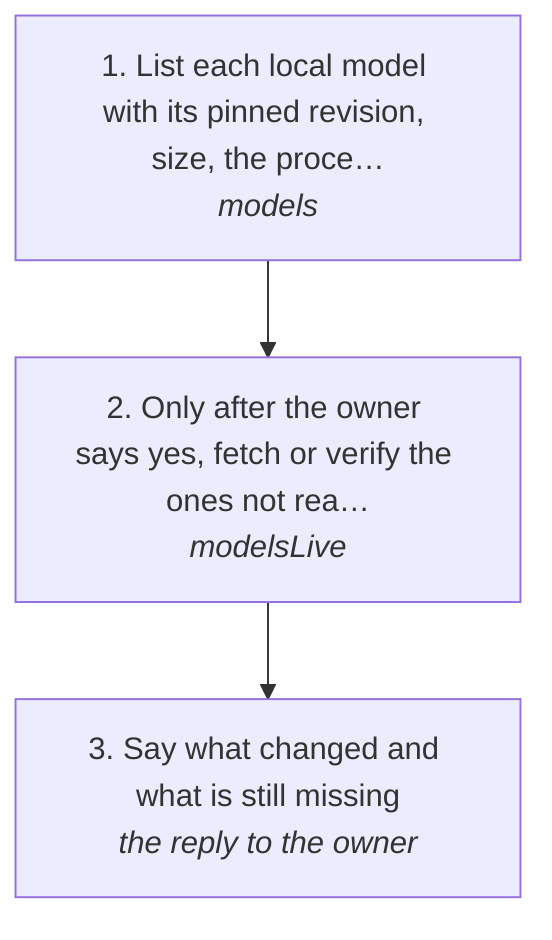

# Local models

See which local models this release pins and whether each is on this machine at that revision, and, with the owner's yes, fetch the missing ones: the judge's injection classifier, the meaning model behind search and the router, the image describer and the mouse planner.

How the owner asks for it: "which models does log use", "fetch the models"

## Run it from a fresh context

Say: **"go on docs/useCases/log/localModels.md"**. The agent reads this page and runs the steps.

## The steps

<!-- stepsDiagram: written by `bun run docs:build` from the steps table below, not edited by hand -->

<!-- /stepsDiagram -->

| # | Step | Tool | Done when |
| --- | --- | --- | --- |
| 1 | List each local model with its pinned revision, size, the process that loads it and whether it is here and matches | `models` {} | the owner sees which are ready |
| 2 | Only after the owner says yes, fetch or verify the ones not ready | `modelsLive` { approvedBy, confirmLive } | it answered each model as already, adopted, downloaded or installed, or refused with `modelFetchFailed` |
| 3 | Say what changed and what is still missing | the reply to the owner | the owner heard the result |

## What to know

- **One version for everything.** Each release pins its models in `src/models/manifest`; `log update` and the install scripts fetch them, so this is for checking or for finishing a fetch that failed offline.
- **No second download.** A matching copy in transformers.js's old cache inside `node_modules` is moved, not downloaded again. Everything lands in `~/.logCli/models`.
- **About 530 MB in all**, most of it the image describer. Check free space first (`runsSpace`).
