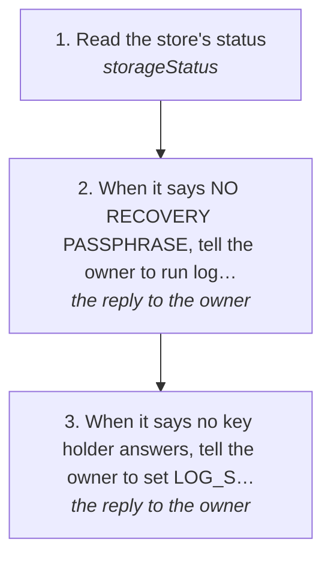

# Secret store status

Read whether log's account sessions, login secrets and provider keys are sealed in log.db, and which files still hold any in plain text. It reads only: nothing is sealed, moved or printed by value. Sealing itself needs no step; log does it the next time it uses each secret (docs/security/encryptedStore.md).

How the owner asks for it: "are my sessions encrypted", "show what is still plain"

## Run it from a fresh context

Say: **"go on docs/useCases/log/secretStore.md"**. The agent reads this page and runs the steps.

## The steps

<!-- stepsDiagram: written by `bun run docs:build` from the steps table below, not edited by hand -->

<!-- /stepsDiagram -->

| # | Step | Tool | Done when |
| --- | --- | --- | --- |
| 1 | Read the store's status | `storageStatus` | the key holders, the sealed counts and every plain file are named |
| 2 | When it says NO RECOVERY PASSPHRASE, tell the owner to run `log storage recovery set` in a terminal (agents cannot) | the reply to the owner | the owner knows a reinstall or new PC loses the sealed logins until he sets one |
| 3 | When it says no key holder answers, tell the owner to set LOG_STORE_PASSPHRASE or run where an OS keystore answers | the reply to the owner | the owner knows which files stay plain and why |

## What to know

- **Nothing to run for the switch.** Each plain secret is sealed on its next read, read back, compared, and only then removed from the file.
- **No key holder, no change.** Without an OS keystore or `LOG_STORE_PASSPHRASE`, files stay as they are and log warns once per file.
- `secretStoreLocked` means log.db has sealed secrets that no holder here opens (a new PC, a reinstall, another user, a different passphrase). The owner runs `log storage recovery set` with his recovery passphrase, and log wraps the key again for this machine.
