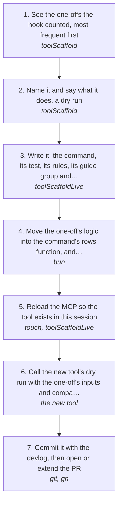

# Turning a hand-rolled one-off into a log tool

When the agent reaches for a one-off to get or change data (a scratch script over log.db, a raw `sqlite3` query, a `curl` to a platform or a link, a `python -c` or `bun -e`), log has no tool for that job yet. The hook labels the call `readsData` or `actsOnData` with what it touched, counts it in log.db, and says so before or right after it runs. It never blocks: the agent may finish the one-off, then makes it a real command and MCP tool so it routes from then on. The owner isn't asked; the guide below is the whole procedure.

How the owner asks for it: "turn that one-off into a tool", "make that script a log command", "stop hand-rolling that", "vendor that query into log"

## Run it from a fresh context

Say: **"go on docs/useCases/log/toolFromOneOff.md for <the one-off>"**. The agent reads this page and runs the steps.

## What the hook labels

Every host's tool call is first unwrapped into the commands it really runs, the files it writes and the code it executes: a shell heredoc that writes a script and runs it, Hermes `execute_code` with `terminal()`, `write_file()`, `subprocess`, `sqlite3.connect` or `requests` inside, a write tool making a scratch script that a later call runs, `browser_exec` code fetching a platform's API, and `tool_call` wrappers (a real `mcp__log__*` tool inside one is never labelled). Then:

| Label | When | Target |
| --- | --- | --- |
| `readsData` | a `SELECT` or a read-only open of log.db, reading `~/.logCli` files, a GET to a platform, resolving a link | `log.db (<tables>)`, `~/.logCli/<folder>`, `<platform> API`, `a link (<host>)` |
| `actsOnData` | `INSERT`, `UPDATE`, `DELETE` on log.db, writing `~/.logCli` files, a POST, PUT or DELETE to a platform | the same |

Not labelled: `git`, `gh`, `bun test`, `tsc`, `log` itself, a `VACUUM INTO` copy of log.db, the devlog, `~/.logCli/mcp` logs, files written inside the repo's `src`, `scripts` or `docs`, every log MCP tool, and `delegate_task`.

## The steps

<!-- stepsDiagram: written by `bun run docs:build` from the steps table below, not edited by hand -->

<!-- /stepsDiagram -->

| # | Step | Tool | Done when |
| --- | --- | --- | --- |
| 1 | See the one-offs the hook counted, most frequent first | `toolScaffold` with no name | the one-off is listed with its label and target |
| 2 | Name it and say what it does, a dry run | `toolScaffold` { name, summary, flags, asks } (acts: true when it changes data) | the planned files and syntax-tree edits are listed |
| 3 | Write it: the command, its test, its rules, its guide group and its use case, then the docs and skills builds | `toolScaffoldLive` { the same, confirmLive: true } | every edit landed and both builds passed |
| 4 | Move the one-off's logic into the command's rows function, and its real case into the test | `src/cli/<name>/index.ts`, `bun test src/cli/<name>` | the test passes on synthetic data |
| 5 | Reload the MCP so the tool exists in this session | `touch src/mcp/server/index.ts` (the reload proxy restarts the server; `toolScaffoldLive` does it) | the tool shows up |
| 6 | Call the new tool's dry run with the one-off's inputs and compare the answers | the new tool | it answers what the one-off answered |
| 7 | Commit it with the devlog, then open or extend the PR | `git commit`, `gh pr create` | the remote branch equals HEAD; the router offers the tool from now on |

## What the runs taught

- **A scratch script over log.db is the usual one.** Finding a person's messages across platforms by name was a `bun` script with `bun:sqlite`, `messages JOIN chats` and `senderLabel LIKE`; it became `saidBy`.
- **Hermes has no hook that can advise before a tool runs.** Its `pre_tool_call` can only block, ask the owner or rewrite the arguments, so on Hermes the advice comes with the call's result (`transform_tool_result`); Claude Code, Codex, OpenCode and Antigravity get it before the call.
- **Name it by the job, not the query.** The name and summary are the tool's description, so the router models find it by what the owner asks for.

## Related

- Up: [All use cases](../README.md)
- [Connect your agent](../../mcp.md) · [Trust](../../trust.md)
