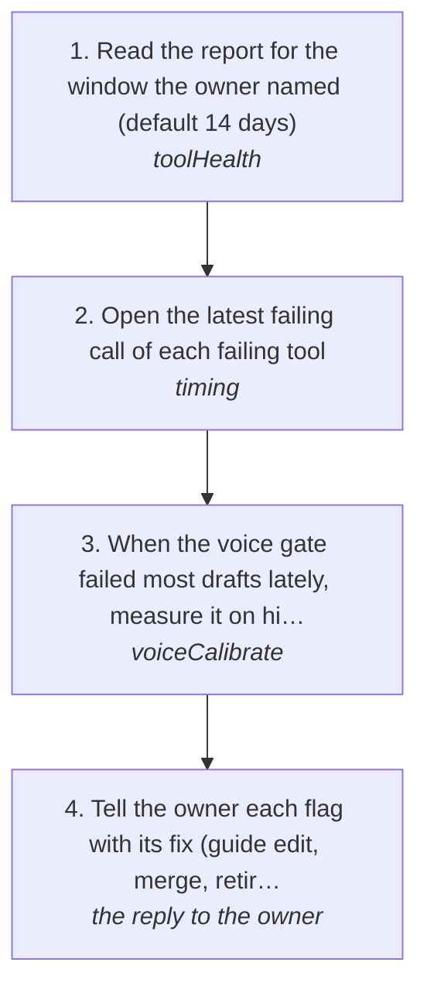

# Tool health

Read how log's own tools are doing from the calls log.db already stores: per tool its calls, failures, commonest failure code, p50 and p95, and last use, with three flags (unused, failing, stale guide mentions) and a fix for each. It reads only: it changes no code, file or guide, and the fixes are for the owner to choose.

How the owner asks for it: "tool health", "which guides went stale"

## Run it from a fresh context

Say: **"go on docs/useCases/log/toolHealth.md"**. The agent reads this page and runs the steps.

## The steps

<!-- stepsDiagram: written by `bun run docs:build` from the steps table below, not edited by hand -->

<!-- /stepsDiagram -->

| # | Step | Tool | Done when |
| --- | --- | --- | --- |
| 1 | Read the report for the window the owner named (default 14 days) | `toolHealth` { days } | each flag is listed with its evidence and its fix |
| 2 | Open the latest failing call of each failing tool | `timing` { call } | the stage and code that failed are named |
| 3 | When the voice gate failed most drafts lately, measure it on his own held-out replies and reset its pass threshold | `voiceCalibrate` | his held-out pass rate before and after and the new threshold are stated |
| 4 | Tell the owner each flag with its fix (guide edit, merge, retire) and change nothing until he picks | the reply to the owner | the owner has the list and chose what to do |

## What to know

- **Unused counts calls only.** The prompt router stores the play it matched, not the tools it listed, so how often a tool was offered and passed over is not known; the report says so rather than guessing.
- **Failing** is more than 20% failed over at least 5 calls. A call's code comes from its root span (`attrs.code`); calls stored before codes were kept show as `uncoded`. Long-running watchers end when they are stopped, so their runs read as failed.
- **Stale** compares each guide's last git commit with the last commit that added or removed a flag line in the module of each tool it names, and flags a call-shaped name (`` `name` { `` ) that no command or flow registers. Guides under `docs/guides` are generated: their fix is `bun run docs:build`.
