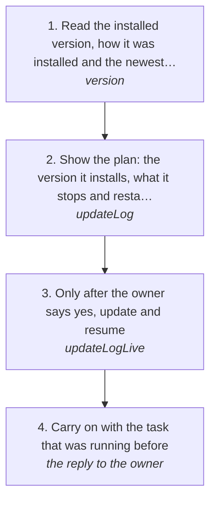

# Update log

Check which log runs here and, with the owner's yes, update it to the newest release and pick up where it left off: the hook service, the account watchers and the open browsers come back after the install. Nothing installs without the owner's yes.

How the owner asks for it: "update log", "which version is this"

## Run it from a fresh context

Say: **"go on docs/useCases/log/updateLog.md"**. The agent reads this page and runs the steps.

## The steps

<!-- stepsDiagram: written by `bun run docs:build` from the steps table below, not edited by hand -->

<!-- /stepsDiagram -->

| # | Step | Tool | Done when |
| --- | --- | --- | --- |
| 1 | Read the installed version, how it was installed and the newest release | `version` { check: true } | the owner knows both versions |
| 2 | Show the plan: the version it installs, what it stops and restarts, anything busy | `updateLog` {} | the owner has the plan |
| 3 | Only after the owner says yes, update and resume | `updateLogLive` { approvedBy, confirmLive } | it answered `updated A -> B, resumed: ...` or refused with the step that failed |
| 4 | Carry on with the task that was running before | the reply to the owner | the owner heard the result |

## What to know

- **Ask first.** With `update.auto` at its default `ask`, the prompt hook says a release is out once per session; the agent asks, and runs `updateLogLive` only after the owner's yes.
- **Busy refuses.** A running job or a queue mid-send holds the update; after about 30 s it refuses with `updateBusy` and nothing is stopped.
- **A failed install or verify rolls back** to the version that ran and restarts what ran (`updateFailed` names the step). `~/.logCli/resume.json` keeps what was running and how far it got. More in docs/updates.md.

## Related

- Up: [All use cases](../README.md)
- [Connect your agent](../../mcp.md) · [Trust](../../trust.md)
