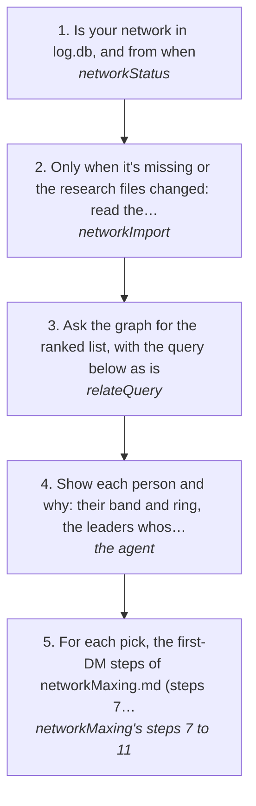

# Who to talk to next

Your network is everyone around the communities and leaders in your space: each person's band (what they could be to you), their ring (how close they sit to you), and whose circles they are in. Once it is in log.db and the Relate graph, one query answers who to talk to next: the people one step from you, in the most leaders' circles, who could collaborate or join, and whom you haven't talked to yet. Each comes with why: the circles, who already connects you, and their last post. The ones you pick go to the first-DM steps of [networkMaxing.md](../twitter/networkMaxing.md).

How the owner asks for it: "who in my network should I talk to", "who's in my network", "who do I need to speak to".

## Run it from a fresh context

Say: **"go on docs/useCases/network/whoToTalkTo.md"**. The agent reads this page and runs the steps. Nothing is sent until step 5, and then only after the owner's yes for each person.

## The steps

<!-- stepsDiagram: written by `bun run docs:build` from the steps table below, not edited by hand -->

<!-- /stepsDiagram -->

| # | Step | Tool | Done when |
| --- | --- | --- | --- |
| 1 | Is your network in log.db, and from when | `networkStatus` {} | the import's date and counts; nothing imported means step 2 |
| 2 | Only when it's missing or the research files changed: read the data folder into log.db (replaces the last import, local only), then rebuild the graph and verify it (see below) | `networkImport` { from } | its counts, and verify says the graph holds what log.db derives |
| 3 | Ask the graph for the ranked list, with the query below as is | `relateQuery` { cypher } | up to 25 rows, ring 2 first |
| 4 | Show each person and why: their band and ring, the leaders whose circles they are in, who in those circles already chats with you (`sameCircleTalksToYou`) and who mentioned them (`mentionedBy`), and their last post. The owner picks who | the agent | the owner's picks |
| 5 | For each pick, the first-DM steps of [networkMaxing.md](../twitter/networkMaxing.md) (steps 7 to 11): follow, like the post, then the opener, gated by the voice gate, each send only after the owner says yes | networkMaxing's steps 7 to 11 | X's answer is `sent` for each |

### The query

People in the network, merged with your chat identities by X handle. Ring 2 replies to your followers; band `collaborator` or `member` and past the map's gates; anyone you already have a DM with is left out. They are ranked by ring 2 first, then shared circles, score and recency of their last post:

```cypher
MATCH (i:Identity)-[:IN_CIRCLE_OF]->(l:Leader) WHERE i.inNetwork AND i.passesGates AND NOT i.owner AND i.band IN ['collaborator', 'member'] AND NOT (i)-[:SAID|MEMBER_OF]->(:Room {kind: 'dm'}) WITH i, count(DISTINCT l) AS circles, collect(DISTINCT l.handle)[0..5] AS leaders ORDER BY CASE WHEN i.ring = 2 THEN 0 ELSE 1 END, circles DESC, i.score DESC, coalesce(i.lastPostAtMs, 0) DESC LIMIT 25 OPTIONAL MATCH (i)-[:IN_CIRCLE_OF]->(:Leader)<-[:IN_CIRCLE_OF]-(c:Identity)-[:SAID]->(:Room {kind: 'dm'}) WITH i, circles, leaders, collect(DISTINCT c.handle)[0..3] AS sameCircleTalksToYou OPTIONAL MATCH (m:Identity)-[:MENTIONED]->(i) WITH i, circles, leaders, sameCircleTalksToYou, collect(DISTINCT m.handle)[0..3] AS mentionedBy RETURN i.handle AS handle, i.band AS band, i.ring AS ring, circles, leaders, sameCircleTalksToYou, mentionedBy, i.score AS score, i.themes AS themes, i.followsOwner AS followsYou, i.lastPost AS lastPost, i.lastPostAtMs AS lastPostAtMs ORDER BY CASE WHEN ring = 2 THEN 0 ELSE 1 END, circles DESC, score DESC, coalesce(lastPostAtMs, 0) DESC
```

## What to know

- **The graph after an import:** `relateBuild` {} projects log.db, your network included, into a new graph file, and `relateVerify` {} checks every count against log.db.

- **Rings:** 1 engaged with you, 2 replies to your followers, 3 follows you, 4 new. Ring 2 comes first because one introduction reaches them.
- **Bands:** `member` could buy, `collaborator` could make things with you; `sponsor`, `affiliate`, `amplifier`, `audience` and `skip` are left out of this query.
- **Why, not just who:** never pitch from the band. The opener is about them and their last post, as in networkMaxing.
- A person in `sameCircleTalksToYou` already chats with you and shares a circle with them: ask the owner whether to ask that person for an intro instead of a cold opener.
- After new conversations, rebuild the graph (`relateBuild`) so the people now in a chat drop out of the list.

## Related

- Up: [All use cases](../README.md)
- [The Relate graph](../../relateGraph.md)
- [Network maxing](../twitter/networkMaxing.md)
