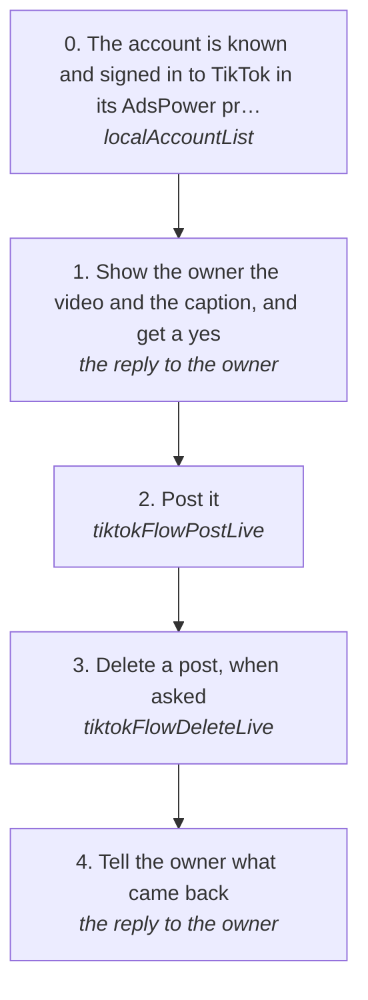

# Posting a video on TikTok, and deleting it

Post one video from the account's own TikTok Studio with a caption, and delete one of its posts, in the account's AdsPower browser. TikTok's own answers decide each step.

How the owner asks for it: "post this on tiktok", "put the video on tiktok", "post it to tiktok with this caption", "delete that tiktok", "take the tiktok down"

## Run it from a fresh context

Say: **"go on docs/useCases/tiktok/post.md"**, with the video file and the caption, or the caption of the post to delete. The agent reads this page and runs the steps.

## The steps

<!-- stepsDiagram: written by `bun run docs:build` from the steps table below, not edited by hand -->

<!-- /stepsDiagram -->

| # | Step | Tool | Done when |
| --- | --- | --- | --- |
| 0 | The account is known and signed in to TikTok in its AdsPower profile | `localAccountList` {} | the TikTok account is listed with its AdsPower profile |
| 1 | Show the owner the video and the caption, and get a yes | the reply to the owner | the owner approved this video and this caption |
| 2 | Post it | `tiktokFlowPostLive` { account, video, fileName, caption, confirmLive: true } | `tiktokWebProjectPostV1` answered `status_code` 0 and an `item_id` |
| 3 | Delete a post, when asked | `tiktokFlowDeleteLive` { account, caption, confirmLive: true } | `tiktokPostEditV1` answered `status_code` 0 for the `aweme_id` it sent |
| 4 | Tell the owner what came back | the reply to the owner | the post's item id, or that it was deleted |

## What the runs taught

- **TikTok Studio, not the feed.** Posting starts at `tiktokstudio/upload` and deleting at `tiktokstudio/content`. The public video page has no delete for the owner.
- **The caption box is found by the file name.** TikTok fills the caption with the video's file name without its extension, so `fileName` is that name and the caption replaces it.
- **A tip covers the form after the first upload.** "Preview your video on your phone" takes every click until Escape closes it (`tiktokPreviewTip`); the flow checks for it again after the upload.
- **The row menu shows only while the row is hovered, past the window's right edge.** `rowMenu` hovers the row by its caption, scrolls across to its unnamed menu button and picks the item by its text.
- **A delete is not final at once.** TikTok keeps it in Recently deleted for 30 days.
