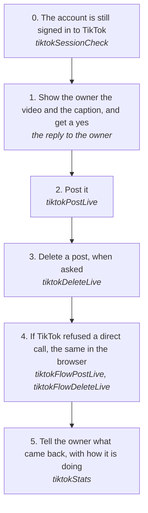

# Posting a video on TikTok, and deleting it

Post one video on the account's TikTok with a caption, and delete one of its posts, on the direct-API engine with no browser: the calls TikTok Studio makes, sent the same way. The AdsPower browser flows are the fallback when TikTok refuses a direct call. TikTok's own answers decide each step.

How the owner asks for it: "post this on tiktok", "put the video on tiktok", "post it to tiktok with this caption", "delete that tiktok", "take the tiktok down"

## Run it from a fresh context

Say: **"go on docs/useCases/tiktok/post.md"**, with the video file and the caption, or the caption of the post to delete. The agent reads this page and runs the steps.

## The steps

<!-- stepsDiagram: written by `bun run docs:build` from the steps table below, not edited by hand -->

<!-- /stepsDiagram -->

| # | Step | Tool | Done when |
| --- | --- | --- | --- |
| 0 | The account is still signed in to TikTok | `tiktokSessionCheck` { account } | TikTok answered loggedIn |
| 1 | Show the owner the video and the caption, and get a yes | the reply to the owner | the owner approved this video and this caption |
| 2 | Post it | `tiktokPostLive` { account, video, caption, approvedBy, confirmLive: true } | TikTok answered `status_code` 0 with an `item_id`, and the post's link came back |
| 3 | Delete a post, when asked | `tiktokDeleteLive` { account, id, approvedBy, confirmLive: true } | TikTok's `edit_diff` names the post and every edit result is 0 |
| 4 | If TikTok refused a direct call, the same in the browser | `tiktokFlowPostLive` { account, video, fileName, caption, confirmLive: true } or `tiktokFlowDeleteLive` { account, caption, confirmLive: true } | `tiktokWebProjectPostV1` or `tiktokPostEditV1` answered `status_code` 0 |
| 5 | Tell the owner what came back, with how it is doing | `tiktokStats` { account } | the post's link, or that it was deleted, and its views so far |

## What the runs taught

- **No browser is needed.** On 2026-11-18 a 73 KB clip posted in 3 s and was deleted in 1 s, direct. TikTok took the calls without its page signatures (`X-Bogus`, `_signature`) or the ticket-guard headers. The upload is signed AWS4 with the keys `/api/v1/video/upload/auth/` hands out.
- **The id to delete is the number in the post's link.** `tiktokStats` lists every post with its link.

- **TikTok Studio, not the feed.** Posting starts at `tiktokstudio/upload` and deleting at `tiktokstudio/content`. The public video page has no delete for the owner.
- **The caption box is found by the file name.** TikTok fills the caption with the video's file name without its extension, so `fileName` is that name and the caption replaces it.
- **A tip covers the form after the first upload.** "Preview your video on your phone" takes every click until Escape closes it (`tiktokPreviewTip`); the flow checks for it again after the upload.
- **The row menu shows only while the row is hovered, past the window's right edge.** `rowMenu` hovers the row by its caption, scrolls across to its unnamed menu button and picks the item by its text.
- **A delete is not final at once.** TikTok keeps it in Recently deleted for 30 days.
