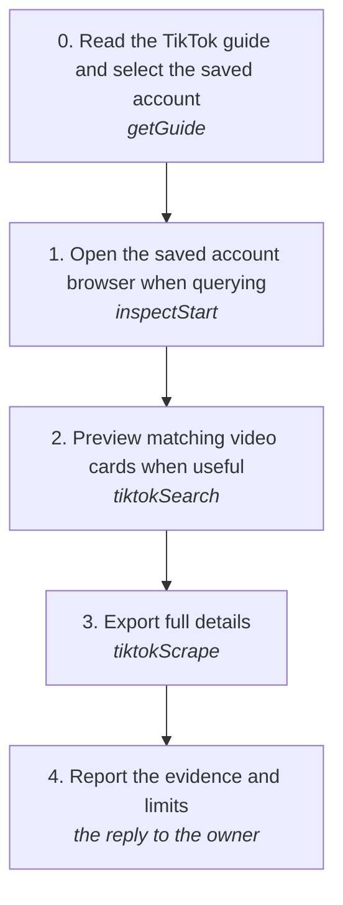

# Researching public TikTok videos

Find videos for a literal query or hashtag and export their full details in one JSON file using Log's bundled extractor.

How the owner asks for it: "export videos with this hashtag", "search TikTok for this query", "get full data from these TikTok videos"

## The steps

<!-- stepsDiagram: written by `bun run docs:build` from the steps table below, not edited by hand -->

<!-- /stepsDiagram -->

| # | Step | Tool | Done when |
| --- | --- | --- | --- |
| 0 | Read the TikTok guide and select the saved account | `getGuide` { topic: "tiktok" } | The account and query or canonical video URL are known |
| 1 | Open the saved account browser when querying | `inspectStart` { account, url: "https://www.tiktok.com/", detach: true } | The existing session is open; any login or checkpoint is resolved by the owner |
| 2 | Preview matching video cards when useful | `tiktokSearch` { account, query, limit, pages, json: true } | The bounded result includes links, source order and the stopping reason |
| 3 | Export full details | `tiktokScrape` { account, query, limit, pages, output, json: true }, or { account, url, output, json: true } | The file contains videos, failures, pending links, extractionComplete and coverage metadata |
| 4 | Report the evidence and limits | the reply to the owner | The file path, extracted count, failures and incomplete coverage are stated |

Use the open account browser. A single canonical URL needs only the internal engine. Search accepts a literal leading hash; it does not guarantee every returned video carries that exact hashtag. Check the extracted hashtags when exact membership matters. Limit is 1–100 videos and pages is 1–10 browser batches. Detail objects preserve the upstream extractor format, including string IDs, nested media and nulls.

No localhost extractor service is needed. Stop on a refusal, checkpoint, cooldown or rate limit. Preserve partial exports and pending links; do not retry through another identity or provider. Raw session evidence stays in the private runtime.

## Related

- [All use cases](../README.md)
- [TikTok implementation](../../platforms/tiktok/README.md)
