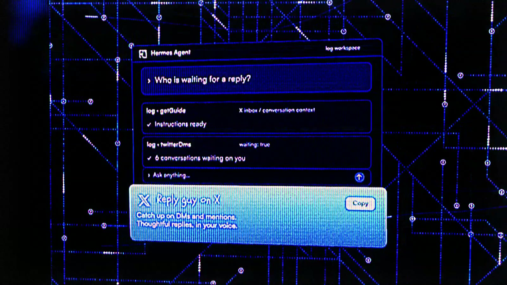
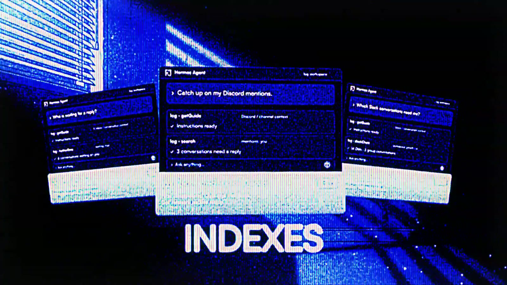
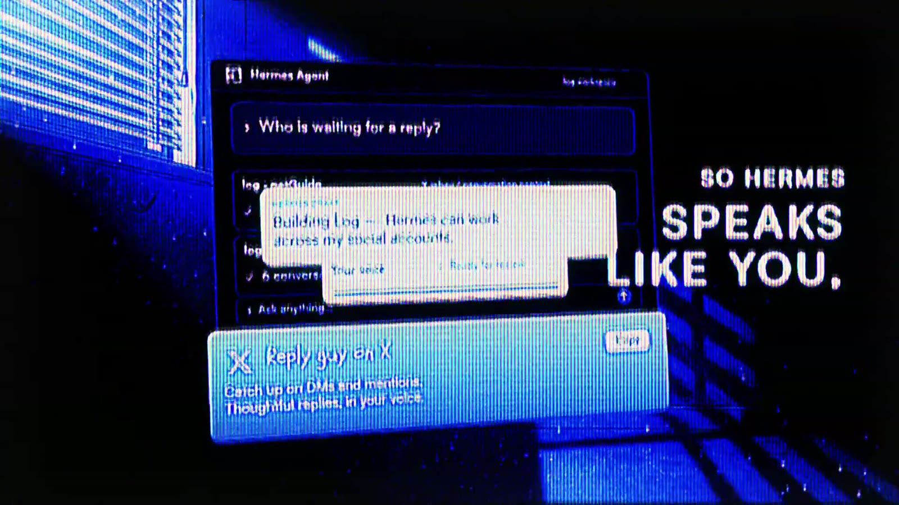
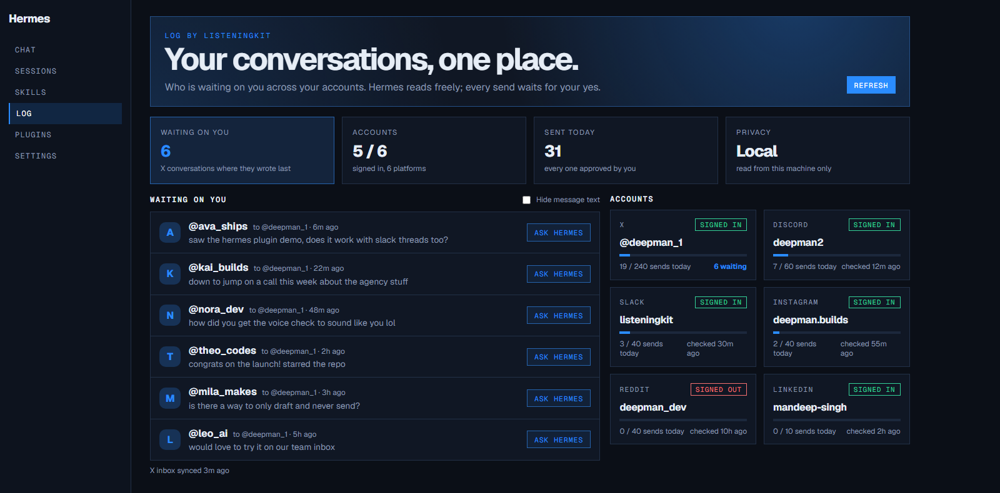

# log for Hermes


Your agent, working your DMs the way you would.

Every conversation you've ever had holds an opportunity: someone waiting on a reply, a follow-up you forgot, a lead that went quiet. This plugin gives Hermes [log by ListeningKit](https://github.com/matthewdonsemail-lab/log), an open-source tool that reads and sends from your own X, Discord, Slack, Instagram and Reddit accounts, in your own voice. LinkedIn sign-in status is available; LinkedIn conversation reads and sends are not built yet.

Ask Hermes things like:

- "Who messaged me on X and Discord today, and who's waiting on a reply?"
- "Read my thread with @someone and draft an answer the way I'd write it."
- "Follow up with everyone who opened my DM but didn't reply."

Hermes reads freely. Every send, reply or post asks you first. Each draft is checked against how you write, every account has daily limits, and everything stays on your machine: [what you control and what log will never do](../docs/trust.md).



| Every platform you're on | Indexes every conversation |
|---|---|
|  |  |



## The log tab

Enable the plugin and Hermes's dashboard gets a **log** tab: who is waiting on a reply, every account you signed in with its session and today's sends against its daily limit. **Ask Hermes** copies a ready prompt for that conversation into your clipboard, so you paste it into chat and Hermes drafts the reply there. The tab only reads; it never sends.



Watch the launch video: [log on X](https://x.com/xAccount/status/2120938715820474690).

## What's inside

One native Hermes plugin, `log` (`plugin.yaml`, `__init__.py`). It used to be two (a portable `log` for the tools and skills, and a native `logHooks` for the hooks) because Hermes lets only a portable package declare an MCP server and only a native plugin register hooks. log's MCP server now comes from `config.yaml` instead, so everything lives in one folder:

- `__init__.py`: registers every play in `skills/` as a skill, log's GenUI tools and recipes from `vendor/hermesGenui`, and the hooks. Its `pre_llm_call` runs log's hook script before each model call and adds what it answers to the turn: the play the prompt asks for, anyone waiting in a signed-in inbox, open browsers on a state log can resolve, and, on a session's first turn, what a session start gets. It finds your log install by itself. When `config.yaml` has no `mcp_servers.log`, it tells the model so, and the command that fixes it.
- `skills/`: every log play, one skill each (`log:log-twitter-dm-inbox`, `log:log-inbox-triage` and so on), generated from log's use cases by `bun run skills:build`, the same skills Claude Code gets. Each one starts by loading its play with `getGuide({ useCase })`, so log's play gate lets its sends through.
- `dashboard/`: the log tab for Hermes's dashboard (`manifest.json`, `plugin_api.py`, `dist/`). Plain JavaScript on the dashboard SDK, no build step and no bundled libraries.
- `desktop/`: the Desktop half (`plugin.js`), which draws log's report views in Hermes Desktop and Webapp replies. When Hermes calls log's `report` tool, log saves the view and the reply carries a `::logapp{tool="report" view="…"}` line; `browserView`'s answer carries `::logbrowser{account="…"}`, the shortcut for `::logapp{tool="browserView"}`. This half claims those lines and draws log's own MCP App widget (the one ChatGPT and Claude get) in a sandboxed iframe, the MCP Apps host card adapted from NousResearch/hermes-agent#75828 (MIT, notice in `src/mcp/apps/report/view/mcpAppsHostLicense.txt`), reading the view and running its tool calls through `dashboard/plugin_api.py` (`/apps/<tool>/resource`, `/result`, `/call`), themed light and dark from Hermes's colours. Older `::logview{id="…"}` lines still draw from `/views/<id>`. Switch it on once in **Capabilities → Plugins → log → Desktop** (in the Webapp, once per browser). It is built from `src/mcp/apps/report/view/hermesDesktop.tsx` by `bun run docs:build` (`scripts/hermes/desktopBundles.ts`), following [hermes-genui](https://github.com/sagarmainkar/hermes-genui) (MIT, vendored in `vendor/hermesGenui`). On chats that can't draw, the plugin swaps the line for the view as text.

## Install

1. Install log and sign in your accounts (it keeps them on your machine). With [Bun](https://bun.sh):

   ```bash
   bun add -g @listeningkit/log
   log launch --setup
   ```

   log's [install guide](https://github.com/matthewdonsemail-lab/log/blob/main/docs/install.md) also has a one-line installer that sets up Bun and the Python its platform engines use. Check `logMcp` is on your PATH.

2. Install the plugin and point Hermes at log's MCP server:

   ```bash
   log launch --setup          # pick Hermes: writes <Hermes home>/plugins/log and retires an old logHooks folder
   hermes plugins enable log
   hermes mcp add log --command logMcp
   ```

   Restart Hermes to load it. To have every write-capable log tool ask for approval first, also run `hermes config set mcp_servers.log.trust untrusted`. A native plugin can't declare an MCP server, so this one line in `config.yaml` is what gives Hermes the `mcp__log__*` tools; until it's there, the hook says so in each turn.

3. Then switch on the Desktop half once: **Capabilities → Plugins → log → Desktop**.

## Disclosure

- **Dashboard tab:** its backend (`dashboard/plugin_api.py`) runs inside Hermes's dashboard only while the plugin is enabled. It reads, read-only, log's own files under `~/.logCli`: each account's `session.json`, its `governor_state.json` (today's request and send counts) and the X inbox log already synced (`inboxSync.json`), including message previews. It makes no network call, runs no command and writes nothing. The tab is served on Hermes's own local dashboard, behind its sign-in.
- **Report views:** the dashboard backend also answers `GET /views/<id>`, reading, read-only, the view log saved under `~/.logCli/views/<id>.json` when `report` ran (its title, its drawn markup and its text). The Desktop half fetches only that route; it draws the markup after dropping every script, event handler, outside link, outside image and remote style, and the view's own code never runs in Hermes's page. A tap on a view's suggested question puts it in the message box through Hermes's composer; nothing is sent by the view itself.
- **Router hook:** the plugin, once enabled, runs `bun <your log install>/scripts/hooks/event.ts` before each model call with the message you sent, and adds its answer (at most 7,500 characters per event) to the turn. That script reads log's local state and starts log's own background services (the context service and, for signed-in accounts, the inbox watchers) the way log's other hooks do.
- **Turns nobody typed:** once `plugins.entries.log.allow_gateway_injection: true` is set, the plugin runs `bun <your log install>/scripts/hooks/push.ts` in the background for the chat you last wrote in, and when one of your accounts receives a message it starts a turn in that chat with log's `>>> NEW MESSAGE` block, through Hermes's own `ctx.inject_message`. It remembers that chat in `~/.logCli/inbox/hermesPush.json` so it carries on after a restart. Without the setting nothing is injected and new messages show on your next message, as before.
- **Local process:** Hermes runs `logMcp` from your log install, from the `mcp_servers.log` entry in `config.yaml`, as a long-running stdio process while Hermes is open. It is not bundled here; you install log yourself.
- **Network calls:** log calls the platforms you signed in (X, Discord, Slack, Instagram, Reddit and LinkedIn) directly, as your own accounts, and only when a tool runs. This plugin adds no telemetry and sends nothing anywhere else.
- **Data and credentials:** your account sessions, cookies and message history stay in log's own folder on your machine (`~/.logCli`). The plugin never reads cookies or credentials; only log does. The dashboard tab reads only the files named above.
- **Writes:** sends, replies, quotes, likes, follows and LinkedIn posts and deletes go out as you, so they are gated by log's own per-account daily limits, and by Hermes approval when `mcp_servers.log.trust` is `untrusted`. log stops on any rate limit, block or failed send instead of retrying.
- **Referral links:** some plays link to services log works with, and those links carry ListeningKit's referral or affiliate code: treg (`treg.to/?ref=`), Memelord (`memelord.com/sign-up?ref=`), Inworld (`inworld.ai/signup?ref=`) and Fish Audio (`fish.audio/?aff=`). Using them costs nothing extra; drop the code from the address if you'd rather not. Every skill with such a link says so at its end.
- **The tool set** comes from your installed log version at runtime and is not covered by this plugin's pinned commit.

## License

MIT
